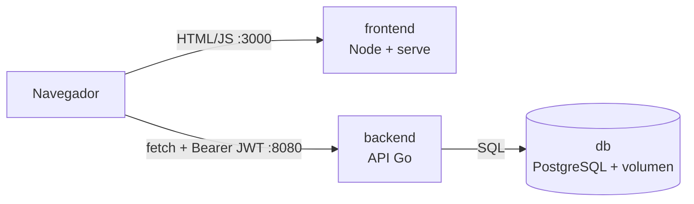

# Cine — Sistema de reservas

Sistema web para reservar asientos de cine. Permite consultar la cartelera y la disponibilidad de asientos por función, y **crear, modificar y cancelar reservas**. La información se guarda de forma centralizada en PostgreSQL.

Proyecto de fin de semestre.

## Integrantes

- Ángel Nahum Salvador
- Héctor Ramírez
- Belén Mariscal

## Stack

| Capa | Tecnología |
|---|---|
| Frontend | Vite + React + TypeScript, React Router, TanStack Query |
| Backend | Go (`net/http`, `pgx`, `goose`, `golang-jwt`) |
| Base de datos | PostgreSQL 17 |
| Infraestructura | Docker + Docker Compose |

## Arquitectura en una imagen



Cada servicio corre en su propio contenedor dentro de una red de Docker Compose. La base de datos no expone puertos al host. Los detalles y las decisiones de diseño están en [`docs/arquitectura.md`](docs/arquitectura.md).

## Inicio rápido

Requisitos: Docker Desktop (o Docker Engine + Compose v2).

```bash
cp .env.example .env      # luego cambia POSTGRES_PASSWORD y JWT_SECRET
docker compose up --build
```

- Frontend: <http://localhost:3000>
- API: <http://localhost:8080/api/healthz>

Usuarios de prueba (los crea el seed; cámbialos fuera de desarrollo):

| Rol | Email | Contraseña |
|---|---|---|
| Administrador | `admin@cine.local` | `Admin123!` |
| Usuario | `user@cine.local` | `User123!` |

La guía completa está en [`docs/manual-instalacion.md`](docs/manual-instalacion.md).

## Estructura del repositorio

```
.
├── backend/            # API en Go (cmd/ + internal/{config,domain,service,store,httpapi,migrations})
├── frontend/           # SPA en React (src/features/* + src/shared/*)
├── docs/               # Documentación del sistema
├── odd/tasks/          # Lista de tareas y bitácora del proyecto
├── docker-compose.yml
├── .env.example
├── CHANGELOG.md
└── README.md
```

## Documentación

| Documento | Contenido |
|---|---|
| [Arquitectura](docs/arquitectura.md) | Contenedores, capas, flujo de una reserva, seguridad y decisiones (ADRs) |
| [API](docs/api.md) | Endpoints, payloads y códigos de error |
| [Base de datos](docs/base-de-datos.md) | Diagrama entidad-relación y restricciones |
| [Manual de instalación](docs/manual-instalacion.md) | Requisitos, variables de entorno, ejecución y solución de problemas |
| [Manual de uso](docs/manual-uso.md) | Cómo reservar, modificar, cancelar y administrar |
| [Tareas](odd/tasks/sistema-reservas-cine.md) | Requisitos, reparto de tareas y bitácora |

## Desarrollo

```bash
# Backend
cd backend && go vet ./... && go test ./...

# Frontend
cd frontend && npm install && npm run dev   # http://localhost:5173
npm run lint && npm test && npm run build
```

Convenciones: commits con [Conventional Commits](https://www.conventionalcommits.org/es/v1.0.0/) (`feat:`, `fix:`, `docs:`…), una tarea por commit y cambios registrados en el [CHANGELOG](CHANGELOG.md).
