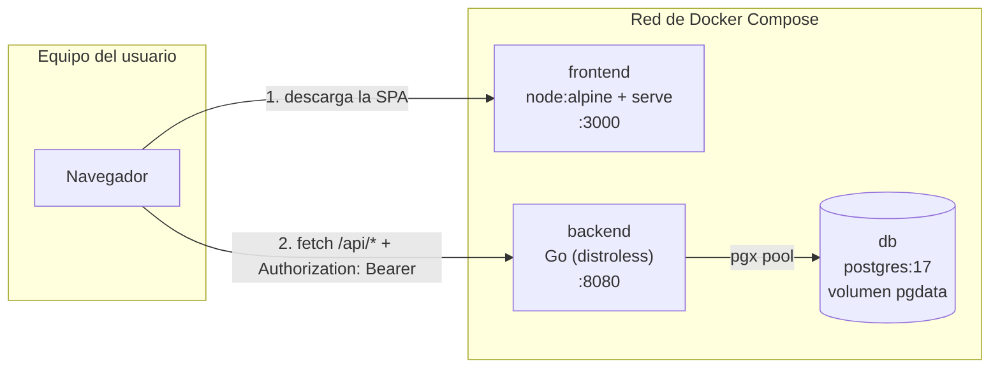

# Arquitectura

## 1. Descripción del sistema

Sistema de reservas de asientos de cine. Un visitante puede ver la cartelera, las funciones de cada película y los asientos libres. Un usuario registrado puede reservar asientos y después modificar o cancelar su reserva. Un administrador gestiona películas y funciones.

## 2. Vista de contenedores



| Servicio | Imagen | Puerto en host | Responsabilidad |
|---|---|---|---|
| `frontend` | multi-stage: `node` (build) → `node:alpine` + `serve` | 3000 | Servir los archivos estáticos de la SPA con headers de seguridad y caché |
| `backend` | multi-stage: `golang` (build) → `distroless/static` | 8080 | Lógica de negocio, validación, autenticación y acceso a datos |
| `db` | `postgres:17-alpine` | — (solo red interna) | Persistir usuarios, películas, funciones, asientos y reservas |

Todos los contenedores corren con un usuario sin privilegios. `docker-compose.yml` define healthchecks y `depends_on: condition: service_healthy`, así que el backend espera a la base de datos.

## 3. Backend por capas

Arquitectura por capas con dependencias hacia adentro. Es una versión ligera de la arquitectura hexagonal, adecuada al alcance del proyecto.

```
cmd/api/main.go            → arma todo (config, pool, servicios, router) y arranca el servidor;
                             `api healthcheck` lo usa Docker (la imagen distroless no tiene curl)
internal/config/           → lee y valida variables de entorno (falla al arrancar si falta algo)
internal/httpapi/           → handlers, DTOs, middleware (auth, CORS, rate limit, logging, recover)
internal/service/          → reglas de negocio: validar asientos, dueño de la reserva, ventana de cancelación
internal/store/postgres/   → repositorios con pgx (SQL parametrizado, transacciones)
internal/domain/           → entidades y errores de negocio (sin dependencias externas)
internal/migrations/       → archivos .sql embebidos, aplicados con goose al arrancar
```

Reglas:

- Los **handlers** solo traducen HTTP ↔ dominio: parsean, validan el formato y mapean errores a códigos HTTP.
- Los **services** deciden: quién puede hacer qué y bajo qué condiciones. La autorización vive aquí, no en el frontend.
- Los **stores** solo hablan SQL. Los services reciben interfaces, así que se pueden probar con implementaciones falsas.

## 4. Frontend por features

```
src/
├── features/
│   ├── auth/           # login, registro, usuario actual
│   ├── movies/         # cartelera y detalle
│   ├── showtimes/      # funciones y mapa de asientos
│   └── reservations/   # mis reservas: ver, modificar, cancelar
│       ├── api.ts          # llamadas HTTP de la feature
│       ├── hooks.ts        # TanStack Query (useQuery/useMutation)
│       ├── containers/     # componentes con datos y lógica
│       └── components/     # componentes presentacionales (solo props)
└── shared/
    ├── api/client.ts       # fetch base: URL, JSON, header Bearer, 401 → cerrar sesión
    ├── auth/tokenStorage.ts# único lugar que lee/escribe el token
    ├── ui/                 # botones, inputs, layout
    └── router.tsx          # rutas con React.lazy (code splitting)
```

La estructura sigue la *screaming architecture*: las carpetas dicen qué hace el sistema (reservas, películas) y no qué framework usa. Dentro de cada feature se separan **contenedores** (datos) y **componentes presentacionales** (UI pura).

## 5. Flujo de una reserva

```mermaid
sequenceDiagram
    actor U as Usuario
    participant F as Frontend
    participant B as API Go
    participant D as PostgreSQL
    U->>F: Elige función y asientos
    F->>B: POST /api/reservations {showtimeId, seatIds} + Bearer
    B->>B: Middleware valida JWT
    B->>B: Service valida: función futura, ≤ 10 asientos, asientos de esa sala
    B->>D: BEGIN; INSERT reservations; INSERT reservation_seats
    alt asiento ya ocupado (violación UNIQUE)
        D-->>B: error 23505
        B->>D: ROLLBACK
        B-->>F: 409 SEAT_TAKEN
        F-->>U: "Uno de los asientos ya fue reservado"
    else ok
        B->>D: COMMIT
        B-->>F: 201 {reservation}
        F->>F: Invalida caché de asientos y de "mis reservas"
        F-->>U: Confirmación
    end
```

## 6. Seguridad

| Amenaza | Medida |
|---|---|
| Contraseñas filtradas | bcrypt (cost 12); nunca se devuelve `password_hash` |
| Enumeración de usuarios | Mismo mensaje para "email no existe" y "contraseña incorrecta" |
| Fuerza bruta | Rate limit en memoria (token bucket por IP) en `/auth/login` y `/auth/register` |
| Inyección SQL | Solo queries parametrizadas con pgx |
| Tokens falsificados | JWT HS256 con secreto ≥ 32 bytes; se validan firma, `exp` y que `alg` sea HS256 |
| Robo de token por XSS | Ver ADR-001: CSP estricta, vida de 1 h, sin `dangerouslySetInnerHTML` |
| Acceso a reservas ajenas | El service compara `reservation.user_id` con el usuario del token → `404` |
| Peticiones de otros orígenes | CORS con allowlist de un solo origen (`FRONTEND_ORIGIN`), sin `*` |
| Payloads gigantes / conexiones lentas | `http.MaxBytesReader` (1 MB) y timeouts de lectura/escritura en el servidor |
| Secretos en el repo | Solo en `.env` (ignorado por git); `.env.example` con valores de ejemplo |
| Exposición de la DB | Sin puerto publicado; solo accesible desde la red de Compose |

Headers de seguridad: `Content-Security-Policy`, `X-Content-Type-Options: nosniff`, `Referrer-Policy: strict-origin-when-cross-origin` y `X-Frame-Options: DENY`. El frontend los envía desde `serve.json` y la API desde un middleware.

## 7. Optimización

- **Backend:** pool de conexiones `pgx`; índices en llaves foráneas y en `showtimes(movie_id, starts_at)`; la disponibilidad de una función sale de **una sola query** (`seats LEFT JOIN reservation_seats`).
- **Frontend:** TanStack Query para caché, deduplicación y reintentos; invalidación puntual después de cada mutación; *code splitting* por ruta con `React.lazy`; assets con hash generados por Vite.
- **Infraestructura:** builds multi-stage (la imagen del backend pesa ~15 MB); `serve` con compresión y `Cache-Control: public, max-age=31536000, immutable` en `/assets`.

## 8. Registro de decisiones (ADRs)

### ADR-001 — Token JWT en `localStorage` en lugar de cookie `HttpOnly`

- **Estado:** aceptada (2026-11-24).
- **Contexto:** El PDF pide un contenedor por servicio y el equipo quiere la infraestructura más simple posible. Para servir el frontend y la API desde el **mismo origen** con cookies hace falta un *reverse proxy* (por ejemplo nginx), que suma configuración que el equipo prefiere evitar.
- **Decisión:** Al iniciar sesión, la API devuelve un **JWT de 1 hora**. El frontend lo guarda en `localStorage` (solo a través de `shared/auth/tokenStorage.ts`) y lo envía en cada petición como `Authorization: Bearer <token>`. El frontend (`:3000`) y la API (`:8080`) son orígenes distintos y se comunican con **CORS**.
- **Por qué:**
  1. **Cero infraestructura extra:** no hay nginx ni proxy; cada servicio se despliega por separado.
  2. **Sin CSRF:** el navegador no adjunta el header `Authorization` por su cuenta, así que un sitio malicioso no puede hacer peticiones en nombre del usuario.
  3. **Simplicidad:** es fácil de depurar (el token se ve en DevTools) y de probar con `curl`.
- **Consecuencias (riesgo aceptado):** cualquier script que corra en la página puede leer `localStorage`. Si hubiera una vulnerabilidad XSS, un atacante podría robar el token. Para mitigarlo:
  - **CSP estricta** (`script-src 'self'`; `connect-src` limitado a la URL de la API), lo que impide ejecutar scripts inyectados o externos.
  - **Vida corta** del token (1 h): un token robado deja de servir pronto.
  - React escapa el contenido por defecto; está **prohibido** usar `dangerouslySetInnerHTML`.
  - `npm audit` y pocas dependencias, para reducir el riesgo de paquetes comprometidos.
  - Al recibir un `401`, el frontend borra el token y manda al login.
  - Logout = borrar el token en el cliente. No hay revocación en el servidor: un token robado sigue siendo válido hasta que expira (máximo 1 h).
- **Alternativa considerada:** cookie `HttpOnly; Secure; SameSite` con CORS y `credentials: 'include'`. Sería **más resistente a XSS**, porque JavaScript no puede leer la cookie, y también funciona sin nginx. Se descartó por simplicidad: exige configurar credenciales en CORS, protección CSRF y el atributo `Secure` en cada entorno. **En un sistema productivo real, se recomienda esta alternativa.**

### ADR-002 — La base de datos garantiza que no haya doble reserva

- **Estado:** aceptada.
- **Contexto:** Dos usuarios pueden intentar reservar el mismo asiento al mismo tiempo. Si solo se verifica en código ("¿está libre?" y después "insertar"), hay una condición de carrera.
- **Decisión:** La tabla `reservation_seats` tiene `UNIQUE (showtime_id, seat_id)`. La API inserta dentro de una transacción y traduce la violación de unicidad (`23505`) a `409 SEAT_TAKEN`. Al cancelar se borran esas filas, y el asiento queda libre otra vez.
- **Consecuencia:** la regla es correcta aunque haya concurrencia, sin bloqueos manuales.

### ADR-003 — `net/http` estándar en lugar de un framework web

- **Estado:** aceptada.
- **Contexto:** Desde Go 1.22, el router estándar acepta métodos y parámetros de ruta (`GET /api/movies/{id}`).
- **Decisión:** Usar `net/http` con middlewares propios y no Gin, Echo ni Fiber.
- **Consecuencia:** menos dependencias, menos superficie de ataque y conocimiento transferible. A cambio, el equipo escribe algunos helpers (JSON, errores) a mano.
