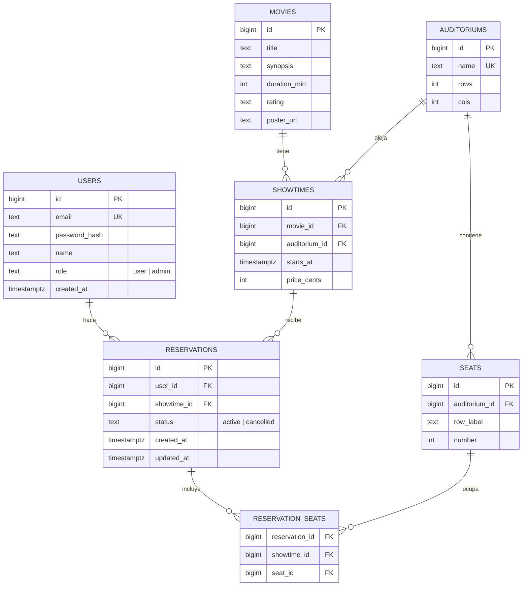

# Base de datos

Motor: PostgreSQL 17. El esquema se versiona con migraciones SQL (`backend/internal/migrations/`), que `goose` aplica automáticamente al arrancar la API. Los datos persisten en el volumen `pgdata`.

## Diagrama entidad-relación



## Tablas y restricciones

| Tabla | Restricciones clave |
|---|---|
| `users` | `email` único (`citext` o `lower(email)`); `role` con `CHECK (role IN ('user','admin'))` |
| `movies` | `duration_min > 0` |
| `auditoriums` | `rows > 0`, `cols > 0` |
| `seats` | `UNIQUE (auditorium_id, row_label, number)`; se generan con el seed a partir de `rows × cols` |
| `showtimes` | `price_cents >= 0`; índice `(movie_id, starts_at)` |
| `reservations` | `status` con `CHECK (status IN ('active','cancelled'))`; índice en `user_id` y en `showtime_id` |
| `reservation_seats` | PK `(reservation_id, seat_id)`; **`UNIQUE (showtime_id, seat_id)`** para evitar la doble reserva |

### ¿Por qué `reservation_seats` repite `showtime_id`?

`showtime_id` también está en `reservations`, pero se repite aquí para que la restricción `UNIQUE (showtime_id, seat_id)` viva en una sola tabla y PostgreSQL la haga cumplir de forma atómica (ver ADR-002 en [arquitectura.md](arquitectura.md)). Al **cancelar**, se borran las filas de esta tabla y la reserva queda con `status = 'cancelled'` como historial.

### Integridad referencial

- `ON DELETE CASCADE` de `reservations` → `reservation_seats`, y de `auditoriums` → `seats`.
- `ON DELETE RESTRICT` en `showtimes` y `movies` cuando tienen reservas: no se puede borrar una función con reservas activas.

## Seed de desarrollo

- 2 salas: "Sala 1" (8 × 10) y "Sala 2" (6 × 8), con sus asientos.
- 4 películas y funciones para los próximos 7 días.
- Usuarios `admin@cine.local` y `user@cine.local` (ver [README](../README.md)).

## Reiniciar la base de datos

```bash
docker compose down -v   # ⚠️ borra el volumen y todos los datos
docker compose up --build
```
